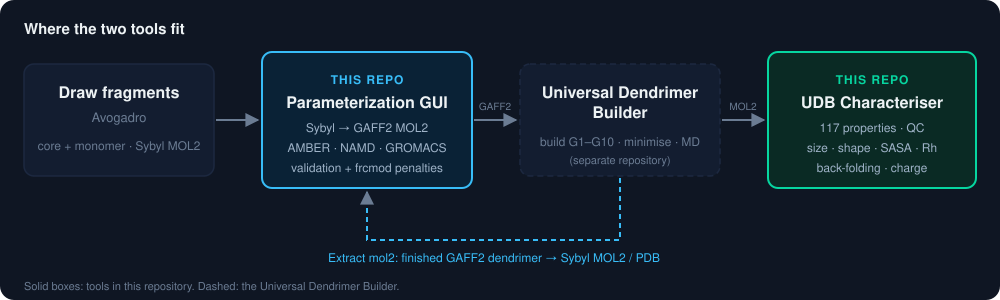
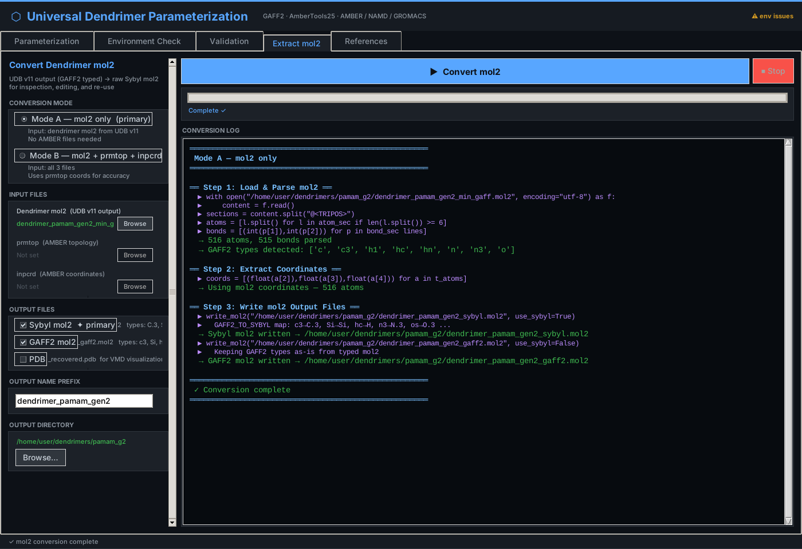
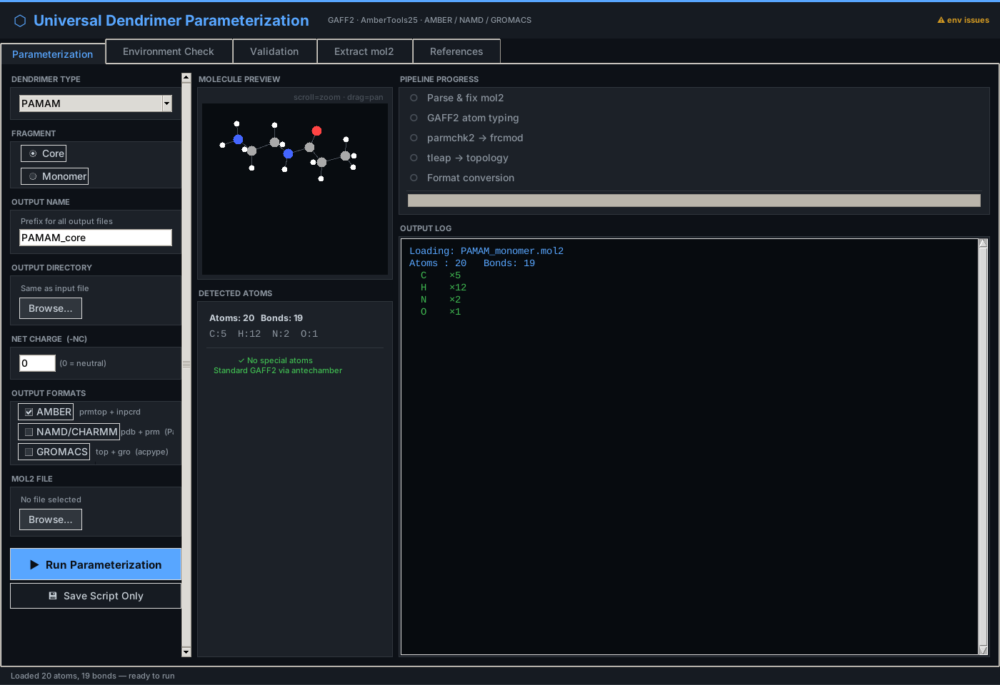
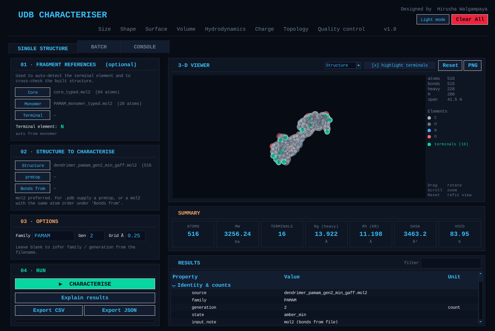
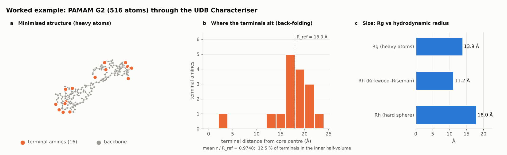

# UDB Characterization Tools

[](https://github.com/HirushaW/UDB-Characterization/actions/workflows/ci.yml)


[](LICENSE)

**Two companion programs for the [Universal Dendrimer Builder (UDB)](https://github.com/HirushaW/universal-dendrimer-builder):**
one prepares the molecules UDB builds from, the other measures the dendrimers UDB produces.

| | Tool | In one sentence |
|---|---|---|
| 🧪 | **[Parameterization GUI](#1-parameterization-gui--mol2-converter)** · `dendrimer_param_gui_v2.py` | Converts MOL2 files between **Sybyl and GAFF2** atom types and builds **AMBER, NAMD/CHARMM and GROMACS** topologies for dendrimer cores and monomers. |
| 📐 | **[UDB Characteriser](#2-udb-characteriser)** · `udb_characterizer.py` | Characterises finished dendrimers: **117 structural and physicochemical properties** with quality control and a plain-language interpretation. |

<p align="center">
  
</p>

---

## 1. Parameterization GUI · MOL2 converter

Fragments drawn in Avogadro carry **Sybyl** atom types; UDB and AMBER need **GAFF2**. This
GUI bridges the two in both directions:

- **Sybyl → GAFF2 (before a build).** Types the core or monomer (including Si, P and S for
  carbosilane and phosphorus dendrimers), runs `parmchk2` and `tleap`, and writes AMBER
  `.prmtop`/`.inpcrd`, NAMD/CHARMM `.psf`/`.pdb` (ParmEd) and GROMACS `.top`/`.gro` (acpype).
- **Validation.** Atom/bond counts, unassigned types, charge sum, bond lengths and `frcmod`
  penalty scores, shown as a checklist.
- **GAFF2 → Sybyl (after a build).** The *Extract mol2* tab turns a finished UDB dendrimer
  back into a Sybyl MOL2 (and PDB) for Avogadro, PyMOL, VMD or CGenFF.

<p align="center">
  
  
</p>
<p align="center"><sub>Left: a PAMAM G2 (516 atoms) converted GAFF2 → Sybyl. Right: a PAMAM monomer ready for GAFF2 parameterization.</sub></p>

## 2. UDB Characteriser

Load the structure UDB built (MOL2, AMBER restart or PDB), optionally with the core and
monomer it was built from, and get:

| Group | Properties |
|---|---|
| **Size** | Rg (all / heavy atoms), equivalent-sphere radius, end-to-end distances |
| **Shape** | asphericity, acylindricity, κ²; exact inertia tensor, principal axes, Ray's asymmetry |
| **Surface & volume** | Shrake–Rupley SASA, grid van der Waals volume, void fraction, density |
| **Hydrodynamics** | Kirkwood–Riseman Rh → diffusion coefficient, sedimentation, intrinsic viscosity |
| **Back-folding** | where the terminal groups sit relative to the core |
| **Charge** | net charge, dipole moment, surface charge density |
| **Topology & QC** | terminal count vs theory, degree of branching, connectivity, bond and clash audits |

Every number comes with its unit, and an *interpretation* layer explains what it means,
tagging each threshold as literature **[lit]**, tool convention **[conv]** or caution **[!]**.
It runs as a GUI or headless from the command line, on one structure or a whole folder.

<p align="center">
  
</p>

**Example output** (PAMAM G2, from [`examples/pamam_g2`](examples/README.md)):

<p align="center">
  
</p>

---

## Quick start

```bash
git clone https://github.com/HirushaW/UDB-Characterization.git
cd UDB-Characterization
pip install -r requirements.txt          # numpy, scipy, matplotlib

python3 udb_characterizer.py             # Characteriser GUI
python3 dendrimer_param_gui_v2.py        # Parameterization GUI
```

Characterise from the command line:

```bash
python3 udb_characterizer.py dendrimer_pamam_gen3_min_gaff.mol2 \
    --core core_typed.mol2 --monomer PAMAM_monomer_typed.mol2 --explain

python3 udb_characterizer.py -r ./Structures/ --monomer PAMAM_monomer_typed.mol2 -o results.csv
```

**Requirements:** Linux, Python 3.10+ with Tkinter (`sudo apt-get install python3-tk`).
Parameterization additionally needs [AmberTools25](https://ambermd.org/AmberTools.php)
(and `acpype` for GROMACS). The Characteriser and GAFF2 → Sybyl conversion need only Python.

<details>
<summary><b>All command-line options</b></summary>

| Option | Default | Meaning |
|---|---|---|
| `--core`, `--monomer`, `--terminal` | – | Fragment MOL2 references |
| `--prmtop`, `--coords` | – | AMBER topology and coordinates (`.inpcrd`, `.rst7`, NetCDF) |
| `--bonds-from` | – | MOL2 whose bonds are copied to a PDB with the same atom order |
| `-r DIR` | – | Characterise every structure under a folder |
| `--terminal-element` | from monomer | Override the terminal element |
| `--family`, `--gen` | from file name | Override family and generation |
| `-o`, `--json` | `udb_post_results.csv` | Output CSV; optional full JSON report |
| `--grid-spacing` | 0.25 Å | Grid for the van der Waals volume |
| `--sasa-points`, `--mc-samples` | 960, 100000 | SASA sphere points; Monte Carlo volume samples |
| `--explain` / `--no-interpret` | – | Print the interpretation / leave it out of the CSV |
| `--units-row` | – | Units on line 2 of the CSV (`*_units.csv` is always written) |
| `--no-extended`, `--strict` | – | Skip extended properties; drop structures that fail QC |

</details>

## Documentation

| | |
|---|---|
| [Property reference](docs/PROPERTIES.md) | Every Characteriser column: formula, unit and literature source |
| [Parameterization & MOL2 guide](docs/PARAMETERIZATION_AND_MOL2.md) | Pipeline, GAFF2 typing rules, full GAFF2 ↔ Sybyl type map, validation checks |
| [Worked example](examples/README.md) | PAMAM G2 inputs and reference outputs of both tools, with the commands |
| [Changelog](CHANGELOG.md) | What changed in each version |

## Repository layout

```
├── udb_characterizer.py         UDB Characteriser (GUI + CLI)
├── dendrimer_param_gui_v2.py    Parameterization GUI / MOL2 converter
├── examples/pamam_g2/           worked example: inputs and reference outputs
├── docs/                        property reference, MOL2 guide, figures
└── tests/                       pytest suite, run by GitHub Actions
```

## Versions and branches

`main` holds stable releases, each tagged (`v1.0.0`, …); `develop` holds ongoing work and is
merged into `main` for each release. Versions follow [Semantic Versioning](https://semver.org).

## Citation

A paper describing UDB is in preparation. Until then, please cite the software
([CITATION.cff](CITATION.cff), or **Cite this repository** on GitHub):

```bibtex
@software{walgampaya2026udbtools,
  author  = {Walgampaya, Hirusha},
  title   = {{UDB Characterization Tools: Structural Characterisation and
             MOL2 Parameterization Companions to the Universal Dendrimer Builder}},
  year    = {2026},
  version = {1.0.0},
  url     = {https://github.com/HirushaW/UDB-Characterization}
}
```

## License and author

[MIT License](LICENSE) © Hirusha Walgampaya. AmberTools, ParmEd, acpype and the other
programs these tools call are separate software under their own licences, and these tools
are not affiliated with them. Questions and bug reports:
[open an issue](https://github.com/HirushaW/UDB-Characterization/issues).
